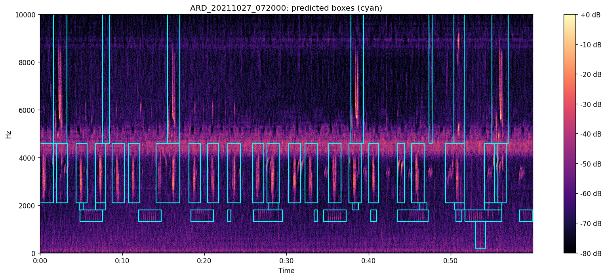
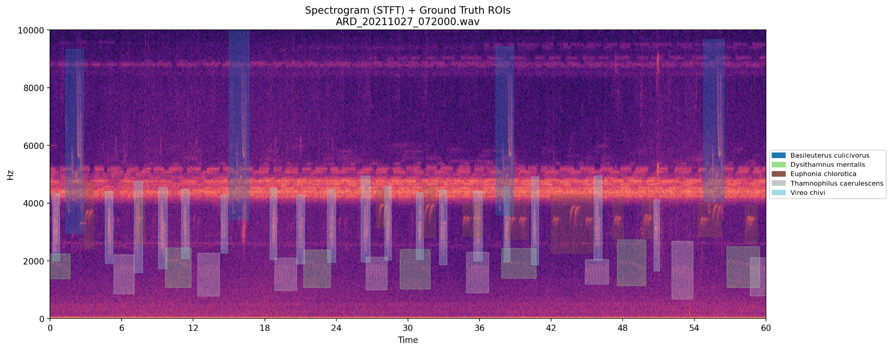
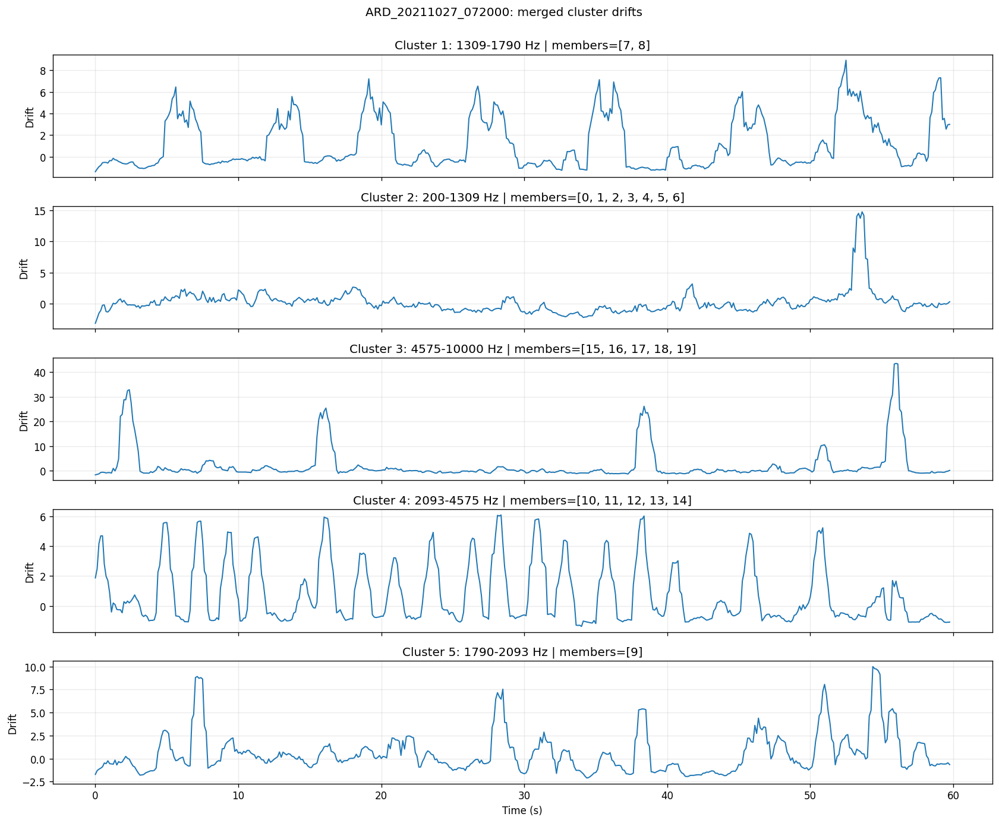

# Adaptive ecoacoustic windowing

Find candidate sound events in a recording, with a start time, end time, and frequency range for each event.

This repository accompanies **Unsupervised Variable–Duration Time–Frequency Acoustic Event Detection through Fine-Band Drift Grouping** by Thomas Napier, Euijoon Ahn, Slade Allen-Ankins, Lin Schwarzkopf, and Ickjai Lee. It is based on the supplied v5 manuscript and the WABAD code in the two accompanying notebooks.

**No species-labelled training data, pretrained model, or GPU is required.** The method learns low-change and high-change states within each recording. Its output is a set of candidate events for expert review, annotation, or downstream analysis. A box is not a species identification, a confirmed animal call, or a separated audio track. Simultaneous events may remain separate when their frequency-band dynamics differ; sounds occupying the same time and frequencies may remain mixed.



*Original WABAD paper example supplied by the author. The runnable walkthrough uses `ARD_20211027_072000.wav` and its matching expert annotation table from the author's planned Zenodo data release.*

## Choose your starting point

| Your goal | Start here |
| --- | --- |
| Start with the original paper example | Download the study data and run [configs/paper_example.json](configs/paper_example.json) |
| Learn what each step does | Open [the guided notebook](notebooks/01_WABAD_walkthrough.ipynb) |
| Analyse the WABAD study dataset | Edit [configs/wabad.json](configs/wabad.json), then follow the batch commands |
| Plot expert annotations with labels | Use [the reference-plot notebook](notebooks/02_WABAD_reference_plots.ipynb) or `plot-gt` |
| Understand or modify the method | Read [the method guide](docs/METHOD.md) and [function reference](docs/API_REFERENCE.md) |
| Compare results with the paper | Read [evaluation and reproduction limits](docs/EVALUATION.md) first |

## Install once

Use Python **3.11 or 3.12** for the documented starting environment. Work from the folder containing this README. Download the repository ZIP and extract it, or clone the repository once it has been published. You also need internet access for the initial Python dependency installation.

```bash
python -m venv .venv
```

Activate the environment using the command for your operating system:

| System | Command |
| --- | --- |
| Windows PowerShell | `.venv\Scripts\Activate.ps1` |
| Windows Command Prompt | `.venv\Scripts\activate.bat` |
| macOS / Linux | `source .venv/bin/activate` |

Then install the software and notebook interface:

```bash
python -m pip install --upgrade pip
python -m pip install -e ".[notebooks]"
```

If Windows blocks PowerShell activation, use Command Prompt or run `.venv\Scripts\python.exe -m pip install -e ".[notebooks]"` directly. On macOS/Linux, use `python3` in place of `python` if required. WAV and FLAC are the supported inputs; start with these to avoid optional compressed-audio decoders. CPU processing is sufficient. Storage and run time depend on recording length and number of plots; start with one short recording. Each recording is loaded into memory.

## Get the study data from Zenodo

**The study data will be supplied by Thomas Napier through Zenodo. The record URL and DOI are pending.** Their release metadata belong in [data_release.json](data_release.json). Follow [the data release guide](docs/DATA_RELEASE.md) to download the study archive once it is available, verify its checksum, and extract it into `data/WABAD`.

This repository includes the author's original paper figures. To run the analysis, supply the real WAV/FLAC recordings and matching Raven/CSV annotation tables from that study release. The upstream WABAD publication is credited under Citation and reuse; its public record is not a substitute for identifying the exact study data release.

The paper-example configuration expects:

```text
data/WABAD/
  ARD/
    recordings/
      ARD_20211027_072000.wav
    annotations/
      ARD_20211027_072000.txt
```

The layout above is the intended release layout. If the released annotation file retains a Raven suffix or uses the `Raven Pro annotations` folder, update `annotation_file` in the example config to its actual path. Keep the original numeric annotation values. The file-format guide explains accepted headers, units and matching.

## Run the original paper example

After downloading the study data, check the two file paths in [configs/paper_example.json](configs/paper_example.json), then run:

```bash
acoustic-windowing run --config configs/paper_example.json --dry-run
acoustic-windowing run --config configs/paper_example.json
acoustic-windowing plot-gt --config configs/paper_example.json
```

Open `outputs/paper_example/single_file/ARD_20211027_072000/`. This folder contains `predicted_boxes.csv`, `spectrogram_boxes.png`, `cluster_drifts.png`, and the separate labelled `ground_truth.png`. Supplied example figures are preserved under `examples/paper/ARD_20211027_072000/`; new results are written under `outputs/`.

Prefer a notebook? Run `jupyter lab`, open `notebooks/01_WABAD_walkthrough.ipynb`, select the installed environment's Python kernel, and run the cells from top to bottom. It is configured for this same ARD recording. Each processing section explains its Input, Processing, and Output.

## Follow one recording through the method

The three figures below are original author-supplied WABAD paper examples, copied unchanged. They can be inspected before downloading the data.

**1. Expert references:** the original spectrogram with labelled reference regions and a species legend. Labels are used for inspection and evaluation, not detector training.



**2. Grouped change:** the five drift trajectories illustrate when the spectral content changes within each discovered frequency group. A group number is not a species ID.

<details>
<summary>View the original grouped-drift figure</summary>



</details>

**3. Event proposals:** the cyan boxes in the image at the top of this README are the resulting candidate time–frequency events. That supplied prediction figure shows proposals only. Regenerated plots can also show the reference boxes as dashed green outlines.

The original example's full run manifest was not supplied, so these images are illustrative reference outputs; exact numeric and pixel agreement must be checked using the real released data and documented settings. No coordinates or audio have been inferred from the images.

## Organise the full study dataset

Use one folder per site under `data/WABAD`. Each site contains a `recordings` folder and its matching `annotations` (or `Raven Pro annotations`) folder. `data_root` can point at the folder containing the sites or at one site. Audio filenames must have unique stems within each site. The batch runner also supports recordings without annotations. See [file formats](docs/DATA_FORMATS.md) for details.

## Change these settings first

Open [configs/wabad.json](configs/wabad.json) in a text editor. **Change `data_root` and `output_dir` to your locations.** Paths are resolved relative to the JSON file, so `../data/WABAD` means `data/WABAD` at the repository root. Use forward slashes on Windows, for example `D:/WABAD`.

| Setting | What to enter | When to change it |
| --- | --- | --- |
| `data_root` | Folder containing sites, or one site folder | Always check this before a run |
| `output_dir` | Folder for new results, preferably outside the input data | Always check this before a run |
| `save_plots` | `true` or `false` | Set to `false` for faster large batches |
| `save_drift_plots` | `true` or `false` | Set to `false` if you only need boxes |
| `resume` | `true` or `false` | Keep `true` to reuse completed matching results |
| `parameters.GMM_MIN_EVENT_POSTERIOR` | Default `0.50` | Higher values generally produce stricter activity decisions; post-processing can also affect box counts |
| `parameters.FMIN` / `FMAX` | Default `200` / `10000`, in Hz | Change for a justified target frequency range |

Leave other scientific settings at their supplied values for your first run. JSON requires double quotes, lowercase `true`/`false` and `null`, and no comments or trailing commas. The [settings guide](docs/CONFIGURATION.md) explains every available parameter and distinguishes routine changes from research changes.

## Run WABAD

```bash
acoustic-windowing run --config configs/wabad.json --dry-run
acoustic-windowing run --config configs/wabad.json --limit 1
acoustic-windowing run --config configs/wabad.json
```

`--dry-run` checks file discovery, readability, duration, annotation columns, units, and matching without running detection or saving results. Inspect the one-recording result before processing the whole dataset.

Rerun the same command after an interruption. Completed results are reused only when the input-file hashes, settings, code, dependency versions, match and all required output files are present. Use `--force` to recompute. Re-running writes the current batch summary; `--limit` summaries cover only the selected recordings. Separate output folders are recommended for different experiments.

## Understand the processing

| Stage | Input | Processing in everyday language | Output |
| --- | --- | --- | --- |
| 1. Load and prepare | WAV/FLAC audio | Convert to mono, resample to 22,050 Hz, and retain the HPSS percussive component | One preprocessed waveform |
| 2. Describe short moments | Waveform | Summarise overlapping 0.25-s windows every 0.125 s using 128-bin Mel spectra and PCEN | One spectral vector per micro-window |
| 3. Measure change | Spectral vectors | Split into 20 frequency bands; measure change between neighbouring windows and smooth it | One drift curve per band |
| 4. Group related bands | Drift curves and band descriptors | Combine timing similarity (70%), profile similarity (20%), and adjacency (10%); group with average-linkage clustering | Related frequency-band groups |
| 5. Find candidate events | Group drift curves | Fit two GMM states per group, smooth decisions, join short gaps, and discard short runs | Variable-duration time–frequency boxes |
| 6. Save and inspect | Boxes, optional references | Export coordinates, draw plots, and optionally measure agreement | CSV, JSON, and PNG results |

Fixed micro-windows measure change; the final event boxes can span multiple micro-windows. Annotations enter validation, plotting, and evaluation only. They do not set detection boundaries in the normal workflow.

## What gets saved

| File | Purpose |
| --- | --- |
| `SITE/RECORDING/predicted_boxes.csv` | Candidate time–frequency coordinates, with units explained in the format guide |
| `SITE/RECORDING/spectrogram_boxes.png` | Proposals in cyan; optional references in green dashed lines |
| `SITE/RECORDING/cluster_drifts.png` | Acoustic-change curves for the discovered band groups |
| `SITE/RECORDING/summary.json` | Counts, paths, and optional evaluation metrics for one recording |
| `SITE/RECORDING/done.json` | Resume fingerprint written only after successful completion |
| `batch_summary.csv` | One row per recording included in this run |
| `batch_failures.csv` | Failed files and error messages; header-only when there are no failures |
| `run_manifest.json` | Resolved settings, dependency versions, Python version, and source hashes |

`cluster_id` identifies a band group within one recording. It is not a species ID and is not comparable across recordings. Box coordinates are metadata: this workflow does not export isolated animal voices or cropped clips.

**Evaluation note:** `notebook_*` metrics retain the supplied notebook's unfiltered IoU evaluation (default 0.30). `conditional_*` metrics are a new implementation of the manuscript's frequency-supported criteria (including IoU@0.50, IoMin and T-Gated). These are different measurements. The repository has not been validated against all WABAD recordings or the paper's original evaluation scripts. It does not claim to reproduce the reported tables or ablations. See [the detailed explanation](docs/EVALUATION.md).

## Where to go next

- [Guided WABAD notebook](notebooks/01_WABAD_walkthrough.ipynb)
- [Reference spectrogram notebook](notebooks/02_WABAD_reference_plots.ipynb)
- [Study data release and download layout](docs/DATA_RELEASE.md)
- [Required files and annotation schema](docs/DATA_FORMATS.md)
- [Original ARD example figures](examples/paper/ARD_20211027_072000/README.md)
- [Every setting and when to change it](docs/CONFIGURATION.md)
- [Scientific method and code map](docs/METHOD.md)
- [Evaluation definitions and reproduction limits](docs/EVALUATION.md)
- [Troubleshooting](docs/TROUBLESHOOTING.md)
- [Source provenance and implementation changes](docs/PROVENANCE.md)
- [Tests and development](CONTRIBUTING.md)
- [Validation performed](docs/VALIDATION.md) and [tested direct dependency versions](requirements-tested.txt)

## Citation and reuse

Cite the accompanying manuscript, the author’s study data release once assigned a DOI, and the [original WABAD dataset publication](https://doi.org/10.1002/ecy.70317) when using their methods or data. The planned study release is described in [data_release.json](data_release.json); its DOI is currently unassigned. [CITATION.cff](CITATION.cff) describes this draft software package; update its release metadata and add the manuscript DOI when available. The source draft does not establish a software licence, so this package intentionally does not invent one. The author should select the appropriate licence before public release; WABAD data retain their separate terms. See [the short release notes](docs/RELEASE_NOTES.md).
